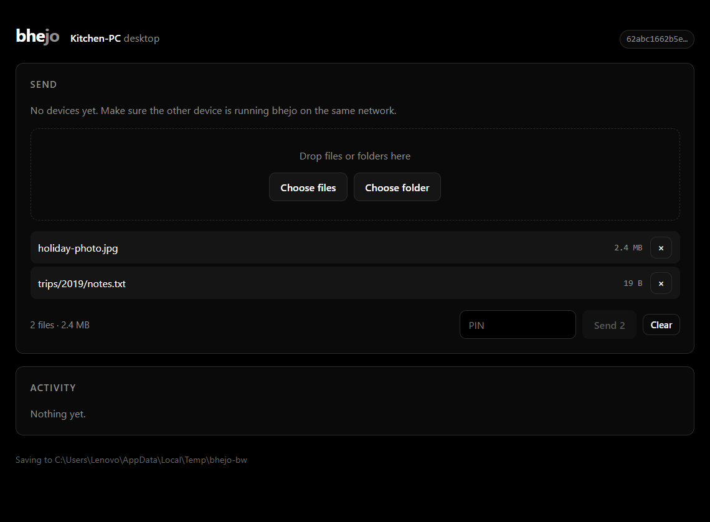

# Bhejo

Send files to the device next to you, over the network you are already on.
No cloud, no accounts, no telemetry, no `node_modules`.

```
  $ bhejo receive                     # on the receiving device
  $ bhejo send ./photos --to Kitchen-PC   # on the sending device
```

Both devices must be on the same Wi-Fi or LAN. Nothing leaves the local network.

Landing page: <https://rushi0105.github.io/bhejo/>

Questions, bugs, or a build for your platform: **[email me](mailto:jdmibusiness01@gmail.com)**.

## Download

| Platform | Build | How |
|---|---|---|
| Windows 10 / 11 | [bhejo-0.1.0-windows.zip](https://rushi0105.github.io/bhejo/downloads/bhejo-0.1.0-windows.zip) | unzip, run `Bhejo.cmd` |
| macOS 12+ | [bhejo-0.1.0-macos.zip](https://rushi0105.github.io/bhejo/downloads/bhejo-0.1.0-macos.zip) | unzip, run `Bhejo.command` |
| Android 10+ | [bhejo-0.1.0-android.apk](https://rushi0105.github.io/bhejo/downloads/bhejo-0.1.0-android.apk) | install the APK directly, no store account |
| iPhone | not built yet | needs a Mac and an Apple developer account |

Both desktop builds are about 50 KB and need Node.js 18.17 or newer installed
once. They are portable — no installer, no registry entry, no background service.
The Android build is a native Kotlin app, 8.8 MB, no Node.js required. The same
files live in [`dist/`](dist/), one folder per platform.



## Why not just use LocalSend?

Use LocalSend — it is excellent, mature, and has a GUI on five platforms. Bhejo
exists for a different trade-off:

| | LocalSend | Bhejo |
|---|---|---|
| Install | Flutter app per platform | Node 18+, nothing else |
| Dependencies | many | zero |
| Interface | GUI + CLI | browser UI + CLI |
| Protocol | multicast + HTTP scan fallback | multicast + broadcast, unicast reply |
| Certificate | generated at runtime | persisted, so fingerprints are stable |

The last row matters. A certificate regenerated on every launch cannot be
verified against anything you saw last week, which makes "trust this device"
meaningless. Bhejo keeps a host key like SSH does and remembers the fingerprints
you accept.

## Requirements

Node.js 18.17 or newer. That is the entire list — `npm install` is not part of
the setup, because there is nothing to install.

Works on Windows, macOS and Linux, plus a native Android app (API 29 and newer).
iOS has no supported path yet (see [Limitations](#limitations)).

## Use

### Receiving

```bash
bhejo                                    # receive into the current folder
bhejo receive --dir ~/Downloads          # receive elsewhere
bhejo receive --pin 4821                 # require senders to know a PIN
bhejo receive --auto-accept              # no prompts (generates a PIN unless --no-pin)
```

The receiver prints its name, address, and TLS fingerprint. Leave it running.

### Browser interface

Every receiver also serves a small local web interface:

```
  browser UI   http://127.0.0.1:53318
```

Open that address in any browser and you can accept or decline incoming
transfers, drag files or whole folders onto the page, pick a nearby device, and
watch progress. Nothing is installed and nothing is downloaded — it is one page
served from the same process.

It is bound to `127.0.0.1`, so it is reachable only from the machine running it.
On a phone that means opening the phone's own address, not your laptop's.

```
--no-ui              terminal prompts only
--ui-port 4000       serve the page somewhere else
```

### Sending

```bash
bhejo discover                              # see who is nearby
bhejo send ./report.pdf --to Kitchen-PC     # by name
bhejo send ./photos --to 192.168.1.20       # by address
bhejo send ./a.txt ./b.txt --to Kitchen-PC --pin 4821
```

Folders are walked recursively and their structure is preserved on the other
side. Files are copied byte for byte — no compression, no re-encoding, so photos
keep their original quality.

On first contact with a device you are asked to confirm its certificate
fingerprint. Compare it with the one printed on the other device. After that the
device is remembered and later transfers skip the prompt.

### Other commands

```
bhejo info              # this device's identity, addresses, known peers
bhejo discover --json   # machine-readable peer list
bhejo cert [file.pem]   # fingerprint of a certificate
bhejo --help
```

Exit codes: `0` success, `1` failure or refusal. Useful in scripts.

## How it works

### Discovery

One UDP socket on port 53317. Every few seconds each device sends a small JSON
announcement to the multicast group `224.0.0.167` and to the limited broadcast
address. Devices that hear it answer by unicast, so two machines that cannot
both receive multicast can still find each other.

```json
{"app":"bhejo","proto":1,"alias":"Kitchen-PC","deviceType":"desktop",
 "port":53317,"fingerprint":"07:2f:…","ts":1792662001909}
```

The address a peer is reachable at always comes from the UDP packet header, never
from the JSON body. A device cannot claim to live somewhere it does not.

Peers that stop announcing expire after 15 seconds.

### Transfer

Two steps, the same shape LocalSend uses: metadata is negotiated and accepted
*before* any bytes are written.

```
GET  /api/v1/info                            identity + fingerprint
POST /api/v1/prepare-upload                  {files:[{id,fileName,size}], pin?}
       -> 200 {sessionId, files:[{id, token}]}
       -> 403 wrong PIN, or the receiver declined
POST /api/v1/upload?sessionId&fileId&token   raw file bytes, streamed to disk
POST /api/v1/cancel?sessionId                abandon a session
```

Sessions carry a per-file token, expire after 10 minutes, and are useless once
consumed. Files are hashed with SHA-256 while they stream in, and the sender
compares that hash with the bytes it sent — so a truncated or corrupted transfer
is reported instead of silently succeeding.

### Ports

| Port | Protocol | Purpose |
|---|---|---|
| 53317 | UDP | discovery |
| 53317 | TCP | HTTPS transfers |
| 53318 | TCP | browser UI, `127.0.0.1` only |

If TCP 53317 is busy, the receiver picks a free port and announces it, so
discovery keeps working.

On Windows, the firewall asks once — allow Node.js on **private networks**.
If devices cannot see each other, that prompt is the first thing to check.

## Security model

**What is protected.** Every transfer runs over TLS 1.2+ (1.3 in practice) with a
self-signed certificate. A passive eavesdropper on the Wi-Fi sees only encrypted
traffic, and file names inside the request bodies are encrypted along with the
content.

**What is verified.** The sender completes the TLS handshake itself, reads the
peer certificate, hashes it, and compares it against the fingerprint learned from
discovery or remembered from a previous transfer. This check happens *before* the
first byte of the request is written. Node's own server-identity check is
deliberately not relied on: with `rejectUnauthorized: false` it is skipped, so
using it as the only guard would fail open.

**What stops unwanted senders.** By default the receiver shows every incoming
request and asks. With `--auto-accept`, a PIN becomes mandatory unless you
explicitly pass `--no-pin`; the receiver prints it at startup and senders must
supply it or be refused before a session is created.

**The browser UI is not trusted just because it says localhost.** A page you
visit can `fetch("http://127.0.0.1:53318/api/send")`, and a cross-origin POST
with a `text/plain` body is a "simple request" that gets sent even though the
reply cannot be read. So every API call needs a header carrying a token that is
generated per run and embedded in the page; a custom header forces a CORS
preflight, which the server never answers. Requests with a foreign `Origin` are
refused, and the `Host` header must be exactly `127.0.0.1:PORT` or
`localhost:PORT`, which also defeats DNS rebinding from an attacker-controlled
hostname that resolves to loopback. The page itself is served with a
`Content-Security-Policy` that forbids any external resource, and peer-supplied
text (aliases, file names) is written with `textContent`, never as HTML.

**What is not protected, stated plainly:**

- A device that already controls the network (your router, an ARP spoofer) can
  block traffic, or impersonate a device *you have never talked to*. The
  fingerprint prompt is what defends this case, and it only works if a human
  actually compares the value. After first contact, impersonation fails.
- Discovery is unauthenticated. Anyone on the LAN can announce an alias and
  appear in the list. They cannot receive your files without either the PIN or
  your acceptance, and they cannot impersonate a remembered device.
- Metadata is visible to the LAN: that a transfer happened, and between which
  addresses. File names and contents are not.
- The private key sits in `~/.bhejo/identity.json` (mode 0600). Anyone who can
  read your user account can impersonate your device.
- There is no per-user authentication. Bhejo authenticates devices, not people.

## Limitations

Honest list of what is not built yet:

- **No resume.** A dropped transfer restarts that file from zero.
- **Sequential uploads.** Files go one at a time; a queue is not parallelised.
- **No desktop app.** The UI is a page served by the receiver, so there is no
  tray icon and no background daemon: something still has to start the process.
  The page is deliberately not reachable from other devices on the LAN.
- **No iOS app.** It needs a Mac, Xcode and a developer account; Android ships
  as a native APK.
- **The Android app must stay in the foreground.** There is no foreground
  service yet, so Android stops the receiver when the app is backgrounded.
- **No group send.** One receiver at a time.
- **No IPv6.** IPv4 only.

## Development

```bash
node --test        # 19 tests: TLS, protocol, hostile filenames, PIN, trust, discovery, UI
```

The tests run a real HTTPS receiver and a real sender against real files, then
compare SHA-256 hashes. They also assert that `../../../evil.txt` and
`C:\Windows\System32\evil.dll` cannot escape the destination directory, that a
wrong PIN creates no files, and that a mismatched fingerprint aborts before the
request is sent.

The UI tests go further: two receivers, two discovery sockets and two UI servers.
One stages a file over the HTTP API and sends it, the other accepts the request
over its own API, and the bytes are compared on disk afterwards. The same suite
replays the two attacks a localhost UI has to survive — a cross-origin POST from
a hostile page and a request with a forged `Host` header — and expects a 403.

Layout:

```
bin/bhejo.mjs       entry point
src/cert.mjs        X.509 encoding, no dependencies
src/util.mjs        path safety, hashing, file walking
src/identity.mjs    persistent device identity
src/discovery.mjs   UDP multicast + broadcast
src/receiver.mjs    HTTPS server, sessions, uploads
src/sender.mjs      pinned TLS client, streaming upload
src/trust.mjs       known-peer fingerprint store
src/ui.mjs          localhost HTTP server for the browser UI
src/ui.html         the page itself, one file, no external assets
src/cli.mjs         command line interface
```

`BHEJO_HOME` overrides the state directory (`~/.bhejo`), which is handy for
running two instances on one machine.

## Pricing

Bhejo is free while it is in beta. Paid plans may be added later; everything
already released under the MIT licence stays available under that licence.

## Contact

[Email me](mailto:jdmibusiness01@gmail.com) — questions, bugs, or a build for your platform.

## License

MIT. See [LICENSE](LICENSE).
